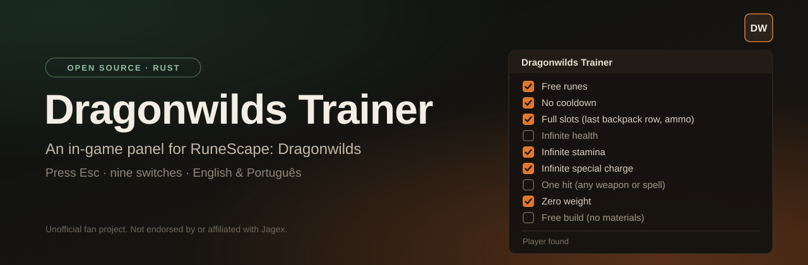
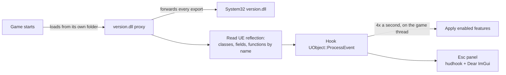

<p align="center">
  
</p>

<p align="center">
  <b>English</b> · <a href="README.pt-BR.md">Português (Brasil)</a>
</p>

<p align="center">
  <a href="https://github.com/gustavczar/dragonwilds-trainer/releases/latest"></a>
  <a href="https://github.com/gustavczar/dragonwilds-trainer/actions/workflows/ci.yml"></a>
  
  
</p>

An open source trainer for **RuneScape: Dragonwilds**, written in Rust. Drop one
file in the game folder, press `Esc` in game, and switch features on and off
from a small panel. No launcher, no installer, nothing running outside the game.

> [!WARNING]
> **Shared worlds are your responsibility.** Jagex's
> [Community Modding Guidelines](https://legal.jagex.com/docs/policies/runescape-dragonwilds-community-modding-guidelines)
> allow cheats in single player and forbid them in shared play. The trainer does
> not switch itself off when others join: the panel shows a warning and the
> features keep running. Use it in a shared world only when everyone there
> agrees, and accept the risk to your account. Some features may not apply in a
> world someone else hosts.

## Features

| Switch | Default | What it does |
| --- | :---: | --- |
| Free runes | on | Keeps the rune pouch full, so spells never run out of runes. |
| No cooldown | on | Spells are ready again right after you cast them. |
| Full slots | on | Keeps the last backpack row and the first ammo slot at each item's maximum stack (50, 99, 999 or 9999). |
| Infinite health | off | Keeps the health bar full; you cannot die. |
| Infinite stamina | on | Keeps stamina full. |
| Infinite special charge | on | Keeps the blue bar under your health full, for special abilities. |
| One hit | off | Any enemy you hit with any weapon or spell dies. Enemies killed this way seem to drop no loot, so switch it off when you want the drops. |
| Zero weight | on | Carried items weigh nothing. |

Your choices are saved in `dw-trainer/settings.json` and come back the next time you play.
The panel speaks English or Portuguese: it follows your Windows display language,
and you can switch it in the panel.

## Install

1. Download `version.dll` from the [latest release](https://github.com/gustavczar/dragonwilds-trainer/releases/latest).
2. Open the game folder (Steam: right-click the game → **Manage** → **Browse local files**)
   and put the file in `RSDragonwilds\Binaries\Win64\`.
3. Start the game as usual. A card in the top-right corner shows the trainer
   loading, step by step, and says **Ready** when it is done (usually under a
   minute; it waits up to 20 minutes on a slow start).
4. Load your world and press `Esc`. Click the **DW** icon in the top-right
   corner to open the panel.

To uninstall, delete `version.dll` and the `dw-trainer` folder next to it.

> [!TIP]
> Back up your save first. The trainer changes your character and inventory,
> and the game saves those changes like any others.

### Verify the download

Every release is built from its tagged source by GitHub Actions, never on a
personal machine. `SHA256SUMS.txt` sits next to the DLL, and with the
[GitHub CLI](https://cli.github.com/) you can check where the file came from:

```sh
gh attestation verify version.dll -R gustavczar/dragonwilds-trainer
```

## FAQ

<details>
<summary><b>The icon does not show up when I press Esc.</b></summary>

The panel draws on top of DirectX 12, the game's default renderer. If you added
`-dx11` to the launch options, remove it. The features still run with your saved
settings without the panel. `dw-trainer/trainer.log` should end with
`trainer ready: press Esc in game`.
</details>

<details>
<summary><b>My antivirus flags the DLL.</b></summary>

Trainers work by loading into the game and hooking one of its functions, which
is what some antivirus heuristics look for. The source is all here, the binary
is built by GitHub Actions, and you can verify it as shown above, or
[build it yourself](#build-from-source).
</details>

<details>
<summary><b>Will a game update break it?</b></summary>

Probably not. The trainer finds every game function and field **by name** through
Unreal Engine's reflection data each time the game starts, instead of using fixed
memory addresses. If something does break, `trainer.log` names what it could not
find. Please open an issue with that file.
</details>

<details>
<summary><b>Can I get banned?</b></summary>

Jagex's modding guidelines allow cheats in single player and forbid them in
shared play, and the trainer does not stop you from using it there. In single
player you follow the guidelines; in a shared world you do not. Either way, no
one can promise anything about a game they do not control. Use it at your own risk.
</details>

<details>
<summary><b>Steam Deck / Linux?</b></summary>

Untested. Under Proton, setting the launch options to
`WINEDLLOVERRIDES="version=n,b" %command%` should load it. Reports are welcome.
</details>

<details>
<summary><b>What else should I know?</b></summary>

- The game ships a crash reporter. If the game crashes while the trainer is loaded,
  the report sent to the developer lists the trainer's DLL.
- With an empty file named `READONLY` in `dw-trainer/`, the trainer only reads the
  game and writes what it finds to the log, without changing anything.
- Tested with game version 1.0.2.2 (Steam build 26658295, Unreal Engine 5.6.1) on Windows 11.
</details>

## How it works



| Crate | Role |
| --- | --- |
| `dw-core` | Platform-independent: the Unreal Engine 5.6 reflection reader and the rules of each feature. Tested without the game. |
| `dw-win` | The `version.dll` the game loads: finds the engine, hooks `UObject::ProcessEvent` for a game-thread tick, applies the features and draws the panel with [hudhook](https://github.com/veeenu/hudhook). |
| `dw-probe` | Developer tool: inspects a running game from outside, read-only. |

## Build from source

Needs [Rust](https://rustup.rs/) (stable) and the MSVC build tools on Windows.

```sh
cargo test --workspace
cargo build -p dw-win --release   # -> target/release/version.dll
```

## Contributing

Issues and pull requests are welcome. For a bug, attach `dw-trainer/trainer.log`
and say which game version you play.

## License and credits

Licensed under either the [Apache License 2.0](LICENSE-APACHE) or the
[MIT license](LICENSE-MIT), at your option. Free, with no paid features.

<sub>Created using intellectual property belonging to Jagex Limited under the terms of Jagex's Fan Content Policy. This content is not endorsed by or affiliated with Jagex. RuneScape and Dragonwilds are trademarks of Jagex Limited.</sub>
