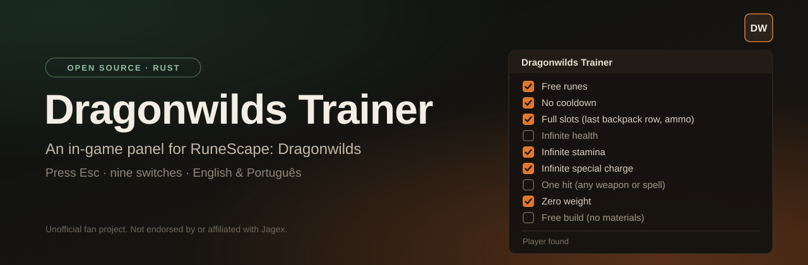
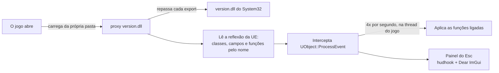

<p align="center">
  
</p>

<p align="center">
  <a href="README.md">English</a> · <b>Português (Brasil)</b>
</p>

<p align="center">
  <a href="https://github.com/gustavczar/dragonwilds-trainer/releases/latest"></a>
  <a href="https://github.com/gustavczar/dragonwilds-trainer/actions/workflows/ci.yml"></a>
  
  
</p>

Um trainer open source para **RuneScape: Dragonwilds**, escrito em Rust. Você
coloca um arquivo na pasta do jogo, aperta `Esc` dentro do jogo e liga ou desliga
as funções num painel pequeno. Sem launcher, sem instalador, nada rodando fora do jogo.

> [!IMPORTANT]
> **Só single player.** As
> [diretrizes de modding da Jagex](https://legal.jagex.com/docs/policies/runescape-dragonwilds-community-modding-guidelines)
> permitem cheats no single player e proíbem no jogo compartilhado. O trainer
> segue essa regra sozinho: enquanto houver outro jogador no seu mundo, todas as
> funções desligam e o painel avisa.

## Funções

| Função | Padrão | O que faz |
| --- | :---: | --- |
| Runas grátis | ligada | Mantém a bolsa de runas cheia: as magias nunca ficam sem runa. |
| Sem cooldown | ligada | As magias ficam prontas logo depois de usadas. |
| Slots cheios | ligada | Mantém a última fileira da mochila e o primeiro slot de munição no máximo de cada item (50, 99, 999 ou 9999). |
| Vida infinita | desligada | Mantém a barra de vida cheia; você não morre. |
| Stamina infinita | ligada | Mantém a stamina cheia. |
| Barra azul infinita | ligada | Mantém cheia a barra azul embaixo da vida, usada pelas habilidades especiais. |
| One Hit | desligada | Qualquer inimigo que você acertar, com qualquer arma ou magia, morre. |
| Peso zero | ligada | Os itens carregados não pesam nada. |

As escolhas ficam salvas em `dw-trainer/settings.json` e voltam na próxima vez que você jogar.
O painel abre em português quando o Windows está em português, e dá para trocar o idioma nele.

## Instalação

1. Baixe o `version.dll` da [versão mais recente](https://github.com/gustavczar/dragonwilds-trainer/releases/latest).
2. Abra a pasta do jogo (Steam: botão direito no jogo → **Gerenciar** → **Procurar arquivos locais**)
   e coloque o arquivo em `RSDragonwilds\Binaries\Win64\`.
3. Abra o jogo como sempre, carregue o seu mundo e aperte `Esc`. Clique no ícone **DW**
   no canto superior direito para abrir o painel.

Para desinstalar, apague o `version.dll` e a pasta `dw-trainer` ao lado dele.

> [!TIP]
> Faça backup do save antes. O trainer muda o seu personagem e o inventário, e o
> jogo salva essas mudanças como qualquer outra.

### Conferir o download

Toda versão é compilada a partir do código da tag pelo GitHub Actions, nunca num
computador pessoal. O `SHA256SUMS.txt` vem junto com a DLL, e com o
[GitHub CLI](https://cli.github.com/) dá para conferir de onde o arquivo veio:

```sh
gh attestation verify version.dll -R gustavczar/dragonwilds-trainer
```

## Perguntas frequentes

<details>
<summary><b>O ícone não aparece quando aperto Esc.</b></summary>

O painel é desenhado sobre o DirectX 12, o renderizador padrão do jogo. Se você
colocou `-dx11` nas opções de inicialização, tire. Sem o painel, as funções
continuam rodando com as escolhas salvas. O `dw-trainer/trainer.log` deve terminar
com `panel ready: press Esc in game`.
</details>

<details>
<summary><b>O antivírus acusou a DLL.</b></summary>

Trainers funcionam entrando no jogo e interceptando uma função dele, que é
justamente o que algumas heurísticas de antivírus procuram. O código está todo
aqui, o binário é compilado pelo GitHub Actions, e dá para conferir como mostrado
acima, ou [compilar você mesmo](#compilar).
</details>

<details>
<summary><b>Uma atualização do jogo vai quebrar o trainer?</b></summary>

Provavelmente não. O trainer acha cada função e campo do jogo **pelo nome**, pelos
dados de reflexão da Unreal Engine, toda vez que o jogo abre, em vez de usar
endereços fixos de memória. Se algo quebrar, o `trainer.log` diz o que não foi
encontrado. Abra uma issue com esse arquivo.
</details>

<details>
<summary><b>Posso ser banido?</b></summary>

As diretrizes de modding da Jagex permitem cheats no single player, e o trainer se
desliga em mundos compartilhados. Mesmo assim, ninguém pode garantir nada sobre um
jogo que não controla. Use por sua conta e risco.
</details>

<details>
<summary><b>Steam Deck / Linux?</b></summary>

Não testado. No Proton, as opções de inicialização
`WINEDLLOVERRIDES="version=n,b" %command%` devem carregá-lo. Relatos são bem-vindos.
</details>

<details>
<summary><b>O que mais eu preciso saber?</b></summary>

- O jogo tem um relatório de crash. Se o jogo travar com o trainer carregado, o
  relatório enviado ao desenvolvedor lista a DLL do trainer.
- Com um arquivo vazio chamado `READONLY` dentro de `dw-trainer/`, o trainer só lê
  o jogo e grava no log o que encontrou, sem mudar nada.
- Testado com o jogo na versão 1.0.2.2 (build Steam 26658295, Unreal Engine 5.6.1) no Windows 11.
</details>

## Como funciona



| Crate | Papel |
| --- | --- |
| `dw-core` | Independente de plataforma: o leitor da reflexão da Unreal Engine 5.6 e as regras de cada função. Testado sem o jogo. |
| `dw-win` | O `version.dll` que o jogo carrega: acha a engine, intercepta o `UObject::ProcessEvent` para ter um tick na thread do jogo, aplica as funções e desenha o painel com o [hudhook](https://github.com/veeenu/hudhook). |
| `dw-probe` | Ferramenta de desenvolvimento: inspeciona o jogo rodando, de fora e só lendo. |

## Compilar

Precisa do [Rust](https://rustup.rs/) (stable) e das ferramentas de build do MSVC no Windows.

```sh
cargo test --workspace
cargo build -p dw-win --release   # -> target/release/version.dll
```

## Contribuir

Issues e pull requests são bem-vindos. Para reportar um bug, anexe o
`dw-trainer/trainer.log` e diga qual versão do jogo você usa. Funções novas
continuam só para single player.

## Licença e créditos

Licenciado, à sua escolha, pela [Apache License 2.0](LICENSE-APACHE) ou pela
[licença MIT](LICENSE-MIT). Gratuito, sem funções pagas.

<sub>Created using intellectual property belonging to Jagex Limited under the terms of Jagex's Fan Content Policy. This content is not endorsed by or affiliated with Jagex. RuneScape e Dragonwilds são marcas da Jagex Limited.</sub>
